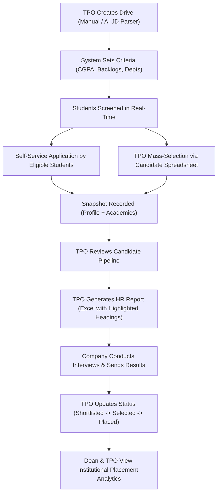

# PlacementHub — Comprehensive System Architecture & Platform Overview

**PlacementHub** is an enterprise-grade, multi-tenant Training and Placement Management System (TPMS) designed for higher education institutions, engineering colleges, and universities. It streamlines the end-to-end campus recruitment lifecycle—from automated job description analysis and real-time eligibility computation to multi-board grade normalization, bulk student onboarding, interactive candidate selection, and sanitized HR reporting.

---

## Table of Contents
1. [Executive Summary](#1-executive-summary)
2. [High-Level Architecture](#2-high-level-architecture)
3. [User Roles & Role-Based Access Control (RBAC)](#3-user-roles--role-based-access-control-rbac)
4. [Core Functional Modules](#4-core-functional-modules)
   - [Recruitment Drive Management](#41-recruitment-drive-management)
   - [Real-Time Deterministic Eligibility Engine](#42-real-time-deterministic-eligibility-engine)
   - [Interactive Candidate Spreadsheet Selector](#43-interactive-candidate-spreadsheet-selector)
   - [HR Export Engine (Highlighted Headings & Multi-Format)](#44-hr-export-engine-highlighted-headings--multi-format)
   - [Canonical 46-Column Bulk Student Import Pipeline](#45-canonical-46-column-bulk-student-import-pipeline)
   - [Multi-Board Grade Normalizer & Academic Progression Timeline](#46-multi-board-grade-normalizer--academic-progression-timeline)
   - [Google Drive Document & Resume Vault](#47-google-drive-document--resume-vault)
   - [Application Snapshotting & Status Audit Trail](#48-application-snapshotting--status-audit-trail)
5. [Agentic AI Architecture & Safe LLM Integration](#5-agentic-ai-architecture--safe-llm-integration)
6. [Technology Stack](#6-technology-stack)
7. [Database Schema & Data Hierarchy](#7-database-schema--data-hierarchy)
8. [End-to-End Recruitment Lifecycle](#8-end-to-end-recruitment-lifecycle)
9. [Setup & Deployment Guide](#9-setup--deployment-guide)

---

## 1. Executive Summary

Campus recruitment involves coordinating across multiple stakeholders: corporate recruiters, Training & Placement Officers (TPOs), academic deans, faculty coordinators, and hundreds or thousands of students. Traditional workflows suffer from:
- **Disparate grading systems**: 10-point CGPA, 4-point scales, percentage formulas, State Board vs. CBSE/ICSE normalization discrepancies.
- **Backlog ambiguities**: Discrepancies between historical backlogs and active uncleared backlogs.
- **Manual, error-prone shortlisting**: Excel sheets with outdated student records, missing email contacts, or unauthorized edits.
- **Privacy vulnerabilities**: Accidentally exposing sensitive student details (Aadhaar, social category, income) in company candidate lists.

**PlacementHub solves these challenges** through strict multi-tenant isolation, automated grade normalization, deterministic eligibility verification, real-time candidate pool filtering, snapshot-based application tracking, and automated HR sheet exports with customizable highlighted headings.

---

## 2. High-Level Architecture

PlacementHub follows a clean decoupled client-server architecture with an authoritative database and an agentic AI sidecar:

```
+-----------------------------------------------------------------------------------+
|                                 CLIENT LAYER                                      |
|  React 18 + TypeScript + Vite SPA                                                 |
|  - TPO Dashboard & Interactive Candidate Excel Selector                           |
|  - Dean Executive Analytics & Department Oversight                                |
|  - Faculty Verification Portal & Class Tracking                                   |
|  - Student Self-Service Portal & Placement Vault                                  |
+-----------------------------------------------------------------------------------+
                                       |
                                HTTPS / JWT
                                       v
+-----------------------------------------------------------------------------------+
|                                 API GATEWAY                                       |
|  FastAPI Router (app/main.py)                                                     |
|  - Multi-Tenant Middleware (Header / Token Tenant Identification)                 |
|  - Role-Based Authorization Guard (RoleChecker: TPO, Dean, Faculty, Student)      |
|  - Audit Logger & Event Dispatcher                                                |
+-----------------------------------------------------------------------------------+
                                       |
         +-----------------------------+-----------------------------+
         v                                                           v
+----------------------------------+        +---------------------------------------+
|    CORE BUSINESS ENGINES         |        |         AGENTIC AI LAYER              |
| - Eligibility Engine             |        | (LLM = Reasoning, DB = Truth)         |
| - Board Conversion Normalizer    | <----> | - Job Description AI Parser           |
| - Academic Progression Timeline  |        | - Student-to-Drive Matching Agent     |
| - Bulk 46-Col Excel Importer     |        | - Human-in-the-Loop Approval Gateway  |
| - OpenPyXL Excel Export Engine   |        +---------------------------------------+
+----------------------------------+
         |
         v
+-----------------------------------------------------------------------------------+
|                             AUTHORITATIVE DATA LAYER                              |
|  MongoDB 6+ Database (PyMongo / Motor Async)                                      |
|  Collections: institutions, programs, departments, classes, students, drives,    |
|               applications, academic_calendars, audit_logs, events                |
+-----------------------------------------------------------------------------------+
```

---

## 3. User Roles & Role-Based Access Control (RBAC)

PlacementHub enforces granular permissions across four distinct personas:

### 1. Training & Placement Officer (TPO)
- **Drive Lifecycle**: Creates, schedules, and modifies placement drives (manually or via AI JD parsing).
- **Candidate Pool Screening**: Uses the spreadsheet-style candidate selector to view, filter by branch/year/section/backlog, and verify real-time student eligibility.
- **Batch Processing**: Direct mass-selection (`Selected`, `Shortlisted`) of eligible students for specific corporate drives.
- **Customized HR Sheet Export**: Configures exact columns to export with highlighted headings (`.xlsx`) or plain CSV.
- **Faculty & Staff Delegation**: Creates and maps department faculty coordinators.
- **Seminar & Event Scheduling**: Schedules pre-placement talks, mock interviews, and assessment tests.

### 2. Dean / Institutional Leadership
- **Executive Oversight**: High-level analytical dashboards showing institution-wide placement percentages, package distributions, top hiring companies, and department performance.
- **Audit Oversight**: Complete audit logs of all role actions, eligibility overrides, and student status changes.
- **Academic Hierarchy Administration**: Manages program durations, department structures, and semester calendars.

### 3. Faculty Coordinator
- **Class-Level Verification**: Reviews student-uploaded academic information, marks certificates, and backlog statuses.
- **Profile Approval Queue**: Approves or requests corrections on student profiles before students become eligible for placement drives.
- **Department Oversight**: Tracks student recruitment attendance and offer acceptances for their assigned branch.

### 4. Student Candidate
- **Academic & Career Profile**: Comprehensive profile containing contact data, multi-level education details, technical skills, projects, internships, and portfolio URLs.
- **Placement Drive Vault**: Direct Google Drive integration for housing transcripts, government IDs, and verifiable PDFs.
- **Opportunity Discovery**: Views all open placement drives with real-time pass/fail eligibility badges (detailed breakdown of why they qualify or what criteria they lack).
- **One-Click Application**: Applies with automatic profile snapshot preservation.
- **Status Timeline**: Tracks stage transitions (`Applied` -> `Shortlisted` -> `Selected` / `Placed`).

---

## 4. Core Functional Modules

### 4.1 Recruitment Drive Management
- Supports On-Campus, Off-Campus, and Hybrid drive modes.
- Defines comprehensive eligibility rules:
  - Minimum Undergraduate CGPA (normalized across grading scales).
  - Maximum Active Backlogs and Maximum Total Historical Backlogs.
  - Secondary (10th) and Higher Secondary / Diploma (12th) percentage minimums.
  - Allowed Programs and Departments.
  - Passing out batch year.
  - Gender preferences (All, Female-only, Male-only).
- CTC breakdown (stipend, base pay, total package, bond duration, drive deadlines).

### 4.2 Real-Time Deterministic Eligibility Engine
Located at `app/services/eligibility_engine.py`:
- Calculates eligibility in real time whenever a student views a drive or a TPO filters candidate pools.
- Produces a deterministic evaluation breakdown with granular status messages:
  - `CGPA 7.4 < 7.5 (Required)`
  - `Active backlogs: 1 > 0 Allowed`
  - `Department 'Civil Engineering' not in allowed departments list`
- Transparently alerts students exactly which criterion prevented eligibility and logs verification checks.

### 4.3 Interactive Candidate Spreadsheet Selector
Located at `frontend/src/components/DriveStudentExcelSelector.tsx`:
- Provides the TPO with a full-screen, spreadsheet-like interface.
- Filters students instantly by Branch, Study Year, Section, CGPA slider, Backlogs limit, and Eligibility state.
- Supports bulk checkboxes (`Check All Eligible`, `Check All Filtered`, `Invert Selection`).
- Displays instant candidate counts, eligible percentages, and quick profile previews.

### 4.4 HR Export Engine (Highlighted Headings & Multi-Format)
- **Dynamic Column Selection**: TPO chooses from 28 modular fields across 4 categories:
  - *Identity & Contact*: Roll Number, Full Name, Gender, Institutional Email, Personal Email, Mobile Number.
  - *Academics*: Department, Class/Section, Program, Study Year, Year of Passing, UG CGPA, UG %, Active Backlogs, Total Backlogs, 10th %, 12th %.
  - *Drive & Eligibility*: Drive Eligibility, Eligibility Remarks, Current Drive Status.
  - *Profiles & Skills*: Resume URL, Technical Skills, Projects, Internships, Certifications, LinkedIn, GitHub, Portfolio.
- **Highlighted Column Headings**:
  - Automatically formats the top header row with background highlight fills (Yellow Highlighter, Excel Green, Corporate Blue, Warm Amber, or Modern Indigo).
  - Uses bold 11pt typography, centered alignment, and clear border delimiters.
  - **Frozen Header Pane (`A2`)**: Headings stay fixed while scrolling down thousands of records.
  - **Auto-Fit Column Widths**: Ensures text and phone numbers are never cut off or rendered as `###`.
  - **Sanitization Guard**: Proactively strips sensitive fields (Aadhaar, social caste, religion, parental finances) before generating company files.
- **Export Formats**: Real `.xlsx` (OpenPyXL) and RFC 4180 CSV with UTF-8 BOM (`\uFEFF`) for universal Excel compatibility.

### 4.5 Canonical 46-Column Bulk Student Import Pipeline
Located at `app/services/excel_importer.py`:
- Ingests institutional master Excel sheets using a standardized 46-column template.
- Detects column aliases automatically (e.g., "Roll No", "Register Number", "Student ID").
- Detects and flags duplicate records across institutional emails, roll numbers, and personal phone numbers.
- Automatically maps imported students into the institution's academic hierarchy (Program -> Department -> Academic Batch -> Class Section).

### 4.6 Multi-Board Grade Normalizer & Academic Progression Timeline
- Located at `app/services/board_conversion_service.py` & `score_normalizer.py`:
  - Translates CBSE CGPA (multiplied by 9.5), Maharashtra State Board, ICSE, and university grading scales into a normalized 0-100 percentage.
- Located at `app/services/academic_timeline_service.py`:
  - Dynamically calculates the student's current study year (e.g., 1st Year, 2nd Year, 3rd Year, 4th Year) using the institutional academic calendar, preventing stale hardcoded year labels.

### 4.7 Google Drive Document & Resume Vault
Located at `app/services/gdrive_vault_service.py` & `components/StudentGDriveVault.tsx`:
- Directly connects student Google Drive storage to maintain verified copies of:
  - Primary Placement Resume / CV.
  - Semester Grade Cards & Transcripts.
  - Government Photo IDs.
  - Internship Offer Letters & Project Certificates.
- Generates secure, sanitized proxy URLs so external recruiters can view approved documents without granting direct editing permissions.

### 4.8 Application Snapshotting & Status Audit Trail
- When a student applies or is selected for a placement drive, PlacementHub takes an **immutable snapshot**:
  - `profile_snapshot`: Student's name, email, phone, skills, resume version, and portfolio links at that exact moment.
  - `academic_snapshot`: Normalized CGPA, 10th/12th percentages, and backlogs at the time of application.
- Subsequent student profile edits do not alter historical drive applications, preserving legal and audit integrity.
- Status history records timestamp, modifier email, and reason for every pipeline change (`Applied` -> `Shortlisted` -> `Selected` -> `Placed`).

---

## 5. Agentic AI Architecture & Safe LLM Integration

PlacementHub incorporates an intelligent AI layer designed under strict safety boundaries:

```
[ Unstructured Input ]           [ AI Agent Router ]               [ Authoritative Backend ]
 Job Description PDF  ------>    LLM Interpretation  ------>   Deterministic Validation Engine
 or HR Requirements                & Parameter Extraction               & MongoDB Storage
                                          |                                    |
                                          v                                    v
                              [ Candidate Match Scoring ]             [ Human-in-the-Loop ]
                                 Semantic Skill Vector                    TPO Approval
                                 & Gap Analysis Draft                     Before Action
```

### Architectural Principles:
1. **LLM is never the single source of truth**: The AI layer cannot directly write to or update database records without schema validation.
2. **Deterministic business logic remains in Python**: Eligibility checks, GPA cutoffs, and backlog filters are always computed by Python rules engines, not LLM hallucinations.
3. **Human Approval Gateway**: AI-generated placement drive drafts require TPO review before publication.

---

## 6. Technology Stack

### Backend
| Technology | Role |
| :--- | :--- |
| **Python 3.12** | Core server runtime |
| **FastAPI** | High-performance asynchronous REST API framework |
| **MongoDB 6+ & Motor** | Asynchronous NoSQL database with tenant partitioning |
| **Pydantic v2** | Strict data validation, schema enforcement, and serialization |
| **OpenPyXL** | Native Excel generation with cell styling, fills, borders, and frozen panes |
| **JWT (PyJWT)** | Stateless role-based authentication and tenant claims |
| **Uvicorn** | Asynchronous ASGI production server |

### Frontend
| Technology | Role |
| :--- | :--- |
| **React 18** | Declarative component UI framework |
| **TypeScript** | Type-safe enterprise application logic |
| **Vite** | Modern, lightning-fast bundler and dev server |
| **CSS Variables** | System-wide theme styling (adaptive Light / Dark modes) |
| **HTML5 Portal API** | Modal and dialog layering with high z-index stacking |

---

## 7. Database Schema & Data Hierarchy

PlacementHub establishes a hierarchical data model ensuring clean multi-tenant isolation:

```
Institution (Tenant Root)
  └── Academic Calendars (Terms, Semesters, Timeline dates)
  └── Programs (e.g., B.Tech, M.Tech, MBA, MCA)
       └── Departments (e.g., Computer Science, Mechanical, Electronics)
            └── Classes / Sections (e.g., CS-A, CS-B, 2022-2026 Batch)
                 └── Students (Profile, Education, Backlogs, Contact, Vault)
                      └── Applications (Drive ID, Snapshots, Status History)
```

### Key Collections:
- `institutions`: Institutional identity, slug, address, accreditation, and admin credentials.
- `students`: Central student records containing identity, contact, normalized education, skills, and verification status.
- `placement_drives`: Drive criteria, company information, CTC details, eligibility constraints, deadlines, and statuses.
- `applications`: Application records joining student and drive with immutable snapshots and audit logs.
- `audit_logs`: Timestamped log of critical actions (`drive_created`, `bulk_status_update`, `hr_export_downloaded`).

---

## 8. End-to-End Recruitment Lifecycle



---

## 9. Setup & Deployment Guide

### Prerequisites
- **Python 3.11+ / 3.12**
- **Node.js 18+ & npm**
- **MongoDB 6.0+** (Local or MongoDB Atlas)

### 1. Backend Setup
```bash
cd backend
python -m venv .venv

# Windows activate
.venv\Scripts\activate
# Linux/macOS activate
# source .venv/bin/activate

pip install -r requirements.txt
```

Create a `.env` file in `backend/`:
```env
MONGODB_URL=mongodb://localhost:27017
DATABASE_NAME=placementhub
JWT_SECRET=your_secure_random_jwt_secret_key_here
JWT_ALGORITHM=HS256
ACCESS_TOKEN_EXPIRE_MINUTES=1440
```

Start the backend server:
```bash
uvicorn app.main:app --reload --port 8000
```
API Documentation will be available at `http://localhost:8000/docs`.

### 2. Frontend Setup
```bash
cd frontend
npm install
npm run dev
```
The application will launch at `http://localhost:5173`.

### 3. Docker Deployment
PlacementHub includes `docker-compose.yml` for unified containerized deployment:
```bash
docker-compose up --build -d
```

---

*PlacementHub — Built for reliable, transparent, and intelligent campus placements.*

